
<a href="https://www.erwinmayer.com"><picture><source media="(prefers-color-scheme: dark)" srcset="assets/hero/hero-dark.svg">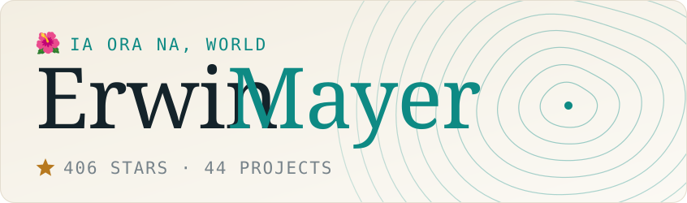</picture></a>

👋 I build software and give most of it away: games, music apps, AI agent tools, smart-home integrations, Windows utilities, editor and browser extensions, and a few things for island life. 
🌐 <a href="https://www.erwinmayer.com"><b>erwinmayer.com</b></a>

<picture><source media="(prefers-color-scheme: dark)" srcset="assets/sections/games-dark.svg"></picture>

<a href="https://mayerwin.github.io/Boom-Buds/"><picture><source media="(prefers-color-scheme: dark)" srcset="assets/cards/boom-buds-dark.svg">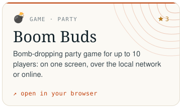</picture></a>
<a href="https://github.com/mayerwin/Boom-Buds"><picture><source media="(prefers-color-scheme: dark)" srcset="assets/cards/_github-dark.svg"></picture></a>
<a href="https://mayerwin.github.io/pong-wars-reloaded/"><picture><source media="(prefers-color-scheme: dark)" srcset="assets/cards/pong-wars-reloaded-dark.svg">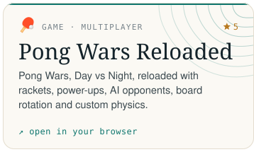</picture></a>
<a href="https://github.com/mayerwin/pong-wars-reloaded"><picture><source media="(prefers-color-scheme: dark)" srcset="assets/cards/_github-dark.svg"></picture></a>
<a href="https://mayerwin.github.io/Escalier-Oh-Hell-Score-Keeper/"><picture><source media="(prefers-color-scheme: dark)" srcset="assets/cards/escalier-dark.svg">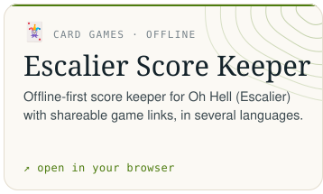</picture></a>
<a href="https://github.com/mayerwin/Escalier-Oh-Hell-Score-Keeper"><picture><source media="(prefers-color-scheme: dark)" srcset="assets/cards/_github-dark.svg"></picture></a>
<a href="https://github.com/mayerwin/BoplFix/releases/latest"><picture><source media="(prefers-color-scheme: dark)" srcset="assets/cards/boplfix-dark.svg">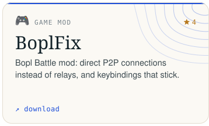</picture></a>
<a href="https://github.com/mayerwin/BoplFix"><picture><source media="(prefers-color-scheme: dark)" srcset="assets/cards/_github-dark.svg"></picture></a>
<a href="https://github.com/mayerwin/Amazing-Digital-Circus-Birthday-Party-App"><picture><source media="(prefers-color-scheme: dark)" srcset="assets/cards/circus-party-dark.svg">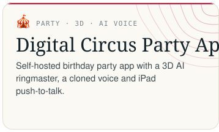</picture></a>
<a href="https://github.com/mayerwin/Amazing-Digital-Circus-Birthday-Party-App"><picture><source media="(prefers-color-scheme: dark)" srcset="assets/cards/_github-dark.svg"></picture></a>

<picture><source media="(prefers-color-scheme: dark)" srcset="assets/sections/music-dark.svg"></picture>

<a href="https://sonora-live.github.io/"><picture><source media="(prefers-color-scheme: dark)" srcset="assets/cards/sonora-live-dark.svg"></picture></a>
<a href="https://github.com/sonora-live/sonora-live"><picture><source media="(prefers-color-scheme: dark)" srcset="assets/cards/_github-dark.svg"></picture></a>
<a href="https://notemaster.erwinmayer.com/"><picture><source media="(prefers-color-scheme: dark)" srcset="assets/cards/note-master-dark.svg">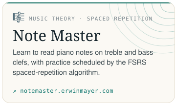</picture></a>

<a href="https://mayerwin.github.io/halloween-soundboard/"><picture><source media="(prefers-color-scheme: dark)" srcset="assets/cards/halloween-soundboard-dark.svg">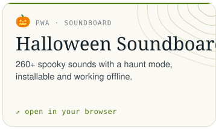</picture></a>
<a href="https://github.com/mayerwin/halloween-soundboard"><picture><source media="(prefers-color-scheme: dark)" srcset="assets/cards/_github-dark.svg"></picture></a>
<a href="https://mayerwin.github.io/MIDI-Notes-Player/"><picture><source media="(prefers-color-scheme: dark)" srcset="assets/cards/midi-notes-player-dark.svg">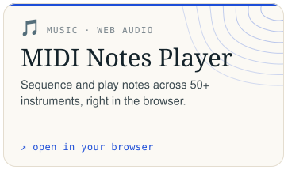</picture></a>
<a href="https://github.com/mayerwin/MIDI-Notes-Player"><picture><source media="(prefers-color-scheme: dark)" srcset="assets/cards/_github-dark.svg"></picture></a>
<a href="https://mayerwin.github.io/Perfect-Bluetooth-MIDI-For-Windows/"><picture><source media="(prefers-color-scheme: dark)" srcset="assets/cards/bt-midi-dark.svg">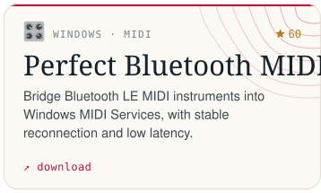</picture></a>
<a href="https://github.com/mayerwin/Perfect-Bluetooth-MIDI-For-Windows"><picture><source media="(prefers-color-scheme: dark)" srcset="assets/cards/_github-dark.svg"></picture></a>

<picture><source media="(prefers-color-scheme: dark)" srcset="assets/sections/backups-dark.svg"></picture>

<a href="https://backspace-backup.github.io/"><picture><source media="(prefers-color-scheme: dark)" srcset="assets/cards/backspace-dark.svg">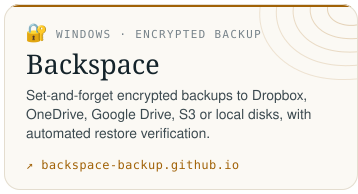</picture></a>
<a href="https://github.com/backspace-backup/backspace"><picture><source media="(prefers-color-scheme: dark)" srcset="assets/cards/_github-dark.svg"></picture></a>
<a href="https://github.com/mayerwin/Photobox-Book-To-PDF"><picture><source media="(prefers-color-scheme: dark)" srcset="assets/cards/photobox-pdf-dark.svg"></picture></a>
<a href="https://github.com/mayerwin/Photobox-Book-To-PDF"><picture><source media="(prefers-color-scheme: dark)" srcset="assets/cards/_github-dark.svg"></picture></a>
<a href="https://github.com/mayerwin/todoist-export"><picture><source media="(prefers-color-scheme: dark)" srcset="assets/cards/todoist-export-dark.svg">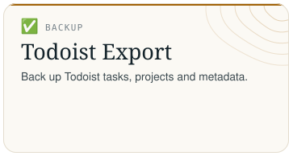</picture></a>
<a href="https://github.com/mayerwin/todoist-export"><picture><source media="(prefers-color-scheme: dark)" srcset="assets/cards/_github-dark.svg"></picture></a>
<a href="https://github.com/mayerwin/trakt-tv-backup"><picture><source media="(prefers-color-scheme: dark)" srcset="assets/cards/trakt-backup-dark.svg">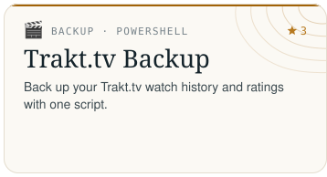</picture></a>
<a href="https://github.com/mayerwin/trakt-tv-backup"><picture><source media="(prefers-color-scheme: dark)" srcset="assets/cards/_github-dark.svg"></picture></a>

<picture><source media="(prefers-color-scheme: dark)" srcset="assets/sections/analytics-dark.svg"></picture>

<a href="https://tidesight-analytics.github.io/"><picture><source media="(prefers-color-scheme: dark)" srcset="assets/cards/tidesight-dark.svg">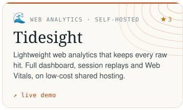</picture></a>
<a href="https://github.com/tidesight-analytics/tidesight"><picture><source media="(prefers-color-scheme: dark)" srcset="assets/cards/_github-dark.svg"></picture></a>

<picture><source media="(prefers-color-scheme: dark)" srcset="assets/sections/boating-dark.svg"></picture>

<a href="https://cap-cotier-polynesie.github.io/"><picture><source media="(prefers-color-scheme: dark)" srcset="assets/cards/cap-cotier-dark.svg">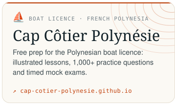</picture></a>
<a href="https://github.com/cap-cotier-polynesie/cap-cotier-polynesie.github.io"><picture><source media="(prefers-color-scheme: dark)" srcset="assets/cards/_github-dark.svg"></picture></a>

<picture><source media="(prefers-color-scheme: dark)" srcset="assets/sections/productivity-dark.svg"></picture>

<a href="https://mayerwin.github.io/Phonestick/"><picture><source media="(prefers-color-scheme: dark)" srcset="assets/cards/phonestick-dark.svg">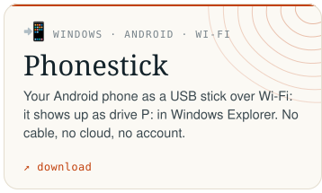</picture></a>
<a href="https://github.com/mayerwin/Phonestick"><picture><source media="(prefers-color-scheme: dark)" srcset="assets/cards/_github-dark.svg"></picture></a>
<a href="https://chainedtimers.github.io/"><picture><source media="(prefers-color-scheme: dark)" srcset="assets/cards/chained-timers-dark.svg">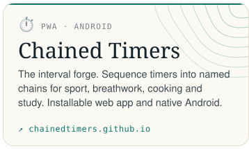</picture></a>
<a href="https://github.com/chainedtimers/chained-timers"><picture><source media="(prefers-color-scheme: dark)" srcset="assets/cards/_github-dark.svg"></picture></a>
<a href="https://whatsphone.github.io/"><picture><source media="(prefers-color-scheme: dark)" srcset="assets/cards/whatsphone-dark.svg">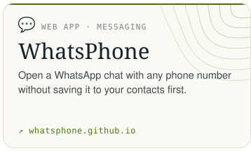</picture></a>
<a href="https://github.com/whatsphone/whatsphone.github.io"><picture><source media="(prefers-color-scheme: dark)" srcset="assets/cards/_github-dark.svg"></picture></a>

<picture><source media="(prefers-color-scheme: dark)" srcset="assets/sections/ai-dark.svg"></picture>

<a href="https://github.com/mayerwin/Agent-Sentinel"><picture><source media="(prefers-color-scheme: dark)" srcset="assets/cards/agent-sentinel-dark.svg">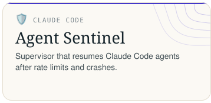</picture></a>
<a href="https://github.com/mayerwin/Agent-Sentinel"><picture><source media="(prefers-color-scheme: dark)" srcset="assets/cards/_github-dark.svg"></picture></a>
<a href="https://github.com/mayerwin/Teleporter"><picture><source media="(prefers-color-scheme: dark)" srcset="assets/cards/teleporter-dark.svg">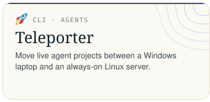</picture></a>
<a href="https://github.com/mayerwin/Teleporter"><picture><source media="(prefers-color-scheme: dark)" srcset="assets/cards/_github-dark.svg"></picture></a>
<a href="https://github.com/mayerwin/open-webui-llamaswap-image-models"><picture><source media="(prefers-color-scheme: dark)" srcset="assets/cards/openwebui-image-models-dark.svg">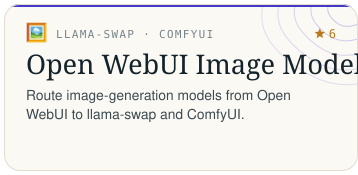</picture></a>
<a href="https://github.com/mayerwin/open-webui-llamaswap-image-models"><picture><source media="(prefers-color-scheme: dark)" srcset="assets/cards/_github-dark.svg"></picture></a>
<a href="https://mayerwin.github.io/AI-Arena-History/"><picture><source media="(prefers-color-scheme: dark)" srcset="assets/cards/ai-arena-history-dark.svg">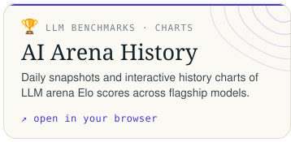</picture></a>
<a href="https://github.com/mayerwin/AI-Arena-History"><picture><source media="(prefers-color-scheme: dark)" srcset="assets/cards/_github-dark.svg"></picture></a>

<picture><source media="(prefers-color-scheme: dark)" srcset="assets/sections/smarthome-dark.svg"></picture>

<a href="https://my.home-assistant.io/redirect/hacs_repository/?owner=mayerwin&repository=HA-Merge-Sensor-History&category=integration"><picture><source media="(prefers-color-scheme: dark)" srcset="assets/cards/ha-merge-history-dark.svg">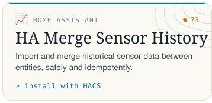</picture></a>
<a href="https://github.com/mayerwin/HA-Merge-Sensor-History"><picture><source media="(prefers-color-scheme: dark)" srcset="assets/cards/_github-dark.svg"></picture></a>
<a href="https://my.home-assistant.io/redirect/hacs_repository/?owner=mayerwin&repository=HA-Real-Last-Changed-Reported-Seen-Sensors&category=integration"><picture><source media="(prefers-color-scheme: dark)" srcset="assets/cards/ha-real-last-changed-dark.svg">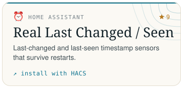</picture></a>
<a href="https://github.com/mayerwin/HA-Real-Last-Changed-Reported-Seen-Sensors"><picture><source media="(prefers-color-scheme: dark)" srcset="assets/cards/_github-dark.svg"></picture></a>
<a href="https://my.home-assistant.io/redirect/hacs_repository/?owner=mayerwin&repository=ha-fusionsolar-statistics&category=dashboard"><picture><source media="(prefers-color-scheme: dark)" srcset="assets/cards/ha-fusionsolar-dark.svg">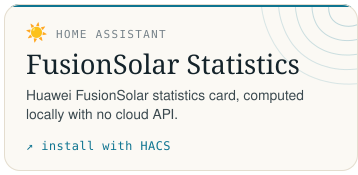</picture></a>
<a href="https://github.com/mayerwin/ha-fusionsolar-statistics"><picture><source media="(prefers-color-scheme: dark)" srcset="assets/cards/_github-dark.svg"></picture></a>
<a href="https://my.home-assistant.io/redirect/hacs_repository/?owner=mayerwin&repository=ha-view-aware-polling&category=integration"><picture><source media="(prefers-color-scheme: dark)" srcset="assets/cards/ha-view-aware-polling-dark.svg">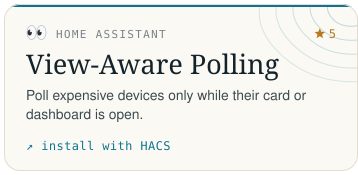</picture></a>
<a href="https://github.com/mayerwin/ha-view-aware-polling"><picture><source media="(prefers-color-scheme: dark)" srcset="assets/cards/_github-dark.svg"></picture></a>
<a href="https://my.home-assistant.io/redirect/hacs_repository/?owner=mayerwin&repository=ha-switchbot-lock-quick-key-support&category=integration"><picture><source media="(prefers-color-scheme: dark)" srcset="assets/cards/ha-switchbot-quick-key-dark.svg">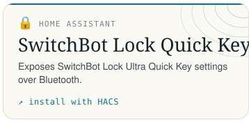</picture></a>
<a href="https://github.com/mayerwin/ha-switchbot-lock-quick-key-support"><picture><source media="(prefers-color-scheme: dark)" srcset="assets/cards/_github-dark.svg"></picture></a>
<a href="https://github.com/mayerwin/HA-Cloudflare-Access-Recovery"><picture><source media="(prefers-color-scheme: dark)" srcset="assets/cards/ha-cloudflare-recovery-dark.svg">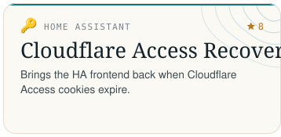</picture></a>
<a href="https://github.com/mayerwin/HA-Cloudflare-Access-Recovery"><picture><source media="(prefers-color-scheme: dark)" srcset="assets/cards/_github-dark.svg"></picture></a>
<a href="https://github.com/mayerwin/frigate-better-face-recognition"><picture><source media="(prefers-color-scheme: dark)" srcset="assets/cards/frigate-face-dark.svg">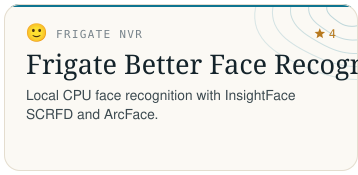</picture></a>
<a href="https://github.com/mayerwin/frigate-better-face-recognition"><picture><source media="(prefers-color-scheme: dark)" srcset="assets/cards/_github-dark.svg"></picture></a>
<a href="https://github.com/mayerwin/frigate-layout-sync"><picture><source media="(prefers-color-scheme: dark)" srcset="assets/cards/frigate-layout-sync-dark.svg">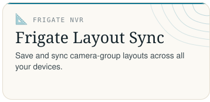</picture></a>
<a href="https://github.com/mayerwin/frigate-layout-sync"><picture><source media="(prefers-color-scheme: dark)" srcset="assets/cards/_github-dark.svg"></picture></a>

<picture><source media="(prefers-color-scheme: dark)" srcset="assets/sections/windows-dark.svg"></picture>

<a href="https://mayerwin.github.io/Video-Capture-Card-Viewer/"><picture><source media="(prefers-color-scheme: dark)" srcset="assets/cards/video-capture-viewer-dark.svg">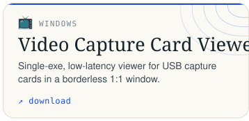</picture></a>
<a href="https://github.com/mayerwin/Video-Capture-Card-Viewer"><picture><source media="(prefers-color-scheme: dark)" srcset="assets/cards/_github-dark.svg"></picture></a>
<a href="https://github.com/mayerwin/extract-audio-tracks-from-video/releases/latest"><picture><source media="(prefers-color-scheme: dark)" srcset="assets/cards/extract-audio-dark.svg">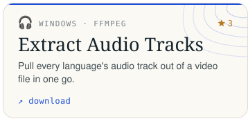</picture></a>
<a href="https://github.com/mayerwin/extract-audio-tracks-from-video"><picture><source media="(prefers-color-scheme: dark)" srcset="assets/cards/_github-dark.svg"></picture></a>
<a href="https://github.com/mayerwin/Network-Adapters-Toggle/releases/latest"><picture><source media="(prefers-color-scheme: dark)" srcset="assets/cards/network-toggle-dark.svg">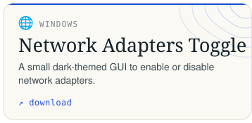</picture></a>
<a href="https://github.com/mayerwin/Network-Adapters-Toggle"><picture><source media="(prefers-color-scheme: dark)" srcset="assets/cards/_github-dark.svg"></picture></a>

<picture><source media="(prefers-color-scheme: dark)" srcset="assets/sections/research-dark.svg"></picture>

<a href="https://mayerwin.github.io/sg-reits-benchmark/"><picture><source media="(prefers-color-scheme: dark)" srcset="assets/cards/sg-reits-benchmark-dark.svg"></picture></a>
<a href="https://github.com/mayerwin/sg-reits-benchmark"><picture><source media="(prefers-color-scheme: dark)" srcset="assets/cards/_github-dark.svg"></picture></a>
<a href="https://github.com/mayerwin/emd-volatility-forecasting"><picture><source media="(prefers-color-scheme: dark)" srcset="assets/cards/emd-volatility-dark.svg">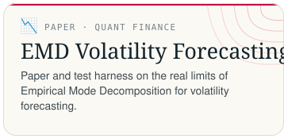</picture></a>
<a href="https://github.com/mayerwin/emd-volatility-forecasting"><picture><source media="(prefers-color-scheme: dark)" srcset="assets/cards/_github-dark.svg"></picture></a>

<picture><source media="(prefers-color-scheme: dark)" srcset="assets/sections/vs-dark.svg"></picture>

<a href="https://marketplace.visualstudio.com/items?itemName=mayerwin.RenameVisualStudioWindowTitle"><picture><source media="(prefers-color-scheme: dark)" srcset="assets/cards/vs-window-title-dark.svg">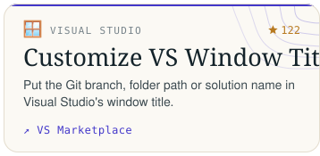</picture></a>
<a href="https://github.com/mayerwin/vs-customize-window-title"><picture><source media="(prefers-color-scheme: dark)" srcset="assets/cards/_github-dark.svg"></picture></a>
<a href="https://marketplace.visualstudio.com/items?itemName=mayerwin.DebugSingleThread"><picture><source media="(prefers-color-scheme: dark)" srcset="assets/cards/vs-debug-single-thread-dark.svg">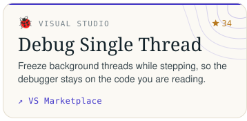</picture></a>
<a href="https://github.com/mayerwin/vs-debug-single-thread"><picture><source media="(prefers-color-scheme: dark)" srcset="assets/cards/_github-dark.svg"></picture></a>
<a href="https://marketplace.visualstudio.com/items?itemName=mayerwin.DisableNoSourceAvailableTab"><picture><source media="(prefers-color-scheme: dark)" srcset="assets/cards/vs-disable-no-source-tab-dark.svg">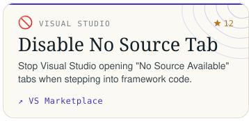</picture></a>
<a href="https://github.com/mayerwin/vs-disable-no-source-tab"><picture><source media="(prefers-color-scheme: dark)" srcset="assets/cards/_github-dark.svg"></picture></a>

<picture><source media="(prefers-color-scheme: dark)" srcset="assets/sections/vscode-dark.svg"></picture>

<a href="https://marketplace.visualstudio.com/items?itemName=mayerwin.ai-agent-sound-notification"><picture><source media="(prefers-color-scheme: dark)" srcset="assets/cards/ai-agent-sound-dark.svg">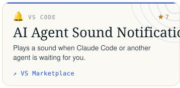</picture></a>
<a href="https://github.com/mayerwin/AI-Agent-Sound-Notification"><picture><source media="(prefers-color-scheme: dark)" srcset="assets/cards/_github-dark.svg"></picture></a>
<a href="https://marketplace.visualstudio.com/items?itemName=mayerwin.explorer-file-filter"><picture><source media="(prefers-color-scheme: dark)" srcset="assets/cards/explorer-file-filter-dark.svg">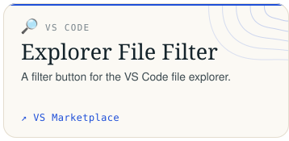</picture></a>
<a href="https://github.com/mayerwin/explorer-file-filter"><picture><source media="(prefers-color-scheme: dark)" srcset="assets/cards/_github-dark.svg"></picture></a>

<picture><source media="(prefers-color-scheme: dark)" srcset="assets/sections/chrome-dark.svg"></picture>

<a href="https://chromewebstore.google.com/detail/bookmark-icon-customizer/fhngdjipelbebhdnkpealakcckpjpjpn"><picture><source media="(prefers-color-scheme: dark)" srcset="assets/cards/bookmark-icon-customizer-dark.svg">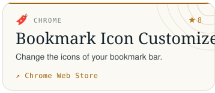</picture></a>
<a href="https://github.com/mayerwin/Bookmark-Icon-Customizer"><picture><source media="(prefers-color-scheme: dark)" srcset="assets/cards/_github-dark.svg"></picture></a>
<a href="https://github.com/mayerwin/superlevels"><picture><source media="(prefers-color-scheme: dark)" srcset="assets/cards/superlevels-dark.svg">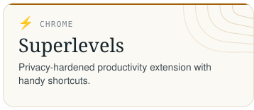</picture></a>
<a href="https://github.com/mayerwin/superlevels"><picture><source media="(prefers-color-scheme: dark)" srcset="assets/cards/_github-dark.svg"></picture></a>

<picture><source media="(prefers-color-scheme: dark)" srcset="assets/sections/thunderbird-dark.svg"></picture>

<a href="https://github.com/mayerwin/thunderbird-hide-all-mail-duplicates/releases/latest"><picture><source media="(prefers-color-scheme: dark)" srcset="assets/cards/thunderbird-dupes-dark.svg">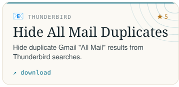</picture></a>
<a href="https://github.com/mayerwin/thunderbird-hide-all-mail-duplicates"><picture><source media="(prefers-color-scheme: dark)" srcset="assets/cards/_github-dark.svg"></picture></a>

📋 <b>All projects as text</b>

### 🎮 Games

- **Boom Buds** ⭐ 3: Bomb-dropping party game for up to 10 players: on one screen, over the local network or online. [open in your browser](https://mayerwin.github.io/Boom-Buds/) · [source](https://github.com/mayerwin/Boom-Buds)
- **Pong Wars Reloaded** ⭐ 5: Pong Wars, Day vs Night, reloaded with rackets, power-ups, AI opponents, board rotation and custom physics. [open in your browser](https://mayerwin.github.io/pong-wars-reloaded/) · [source](https://github.com/mayerwin/pong-wars-reloaded)
- **Escalier Score Keeper**: Offline-first score keeper for Oh Hell (Escalier) with shareable game links, in several languages. [open in your browser](https://mayerwin.github.io/Escalier-Oh-Hell-Score-Keeper/) · [source](https://github.com/mayerwin/Escalier-Oh-Hell-Score-Keeper)
- **BoplFix** ⭐ 4: Bopl Battle mod: direct P2P connections instead of relays, and keybindings that stick. [download](https://github.com/mayerwin/BoplFix/releases/latest) · [source](https://github.com/mayerwin/BoplFix)
- **Digital Circus Party App**: Self-hosted birthday party app with a 3D AI ringmaster, a cloned voice and iPad push-to-talk. [source](https://github.com/mayerwin/Amazing-Digital-Circus-Birthday-Party-App)

### 🎹 Music

- **Sonora Live** ⭐ 3: Remote music lessons in the browser: P2P video, pure instrument audio and two-way MIDI between teacher and student pianos. [sonora-live.github.io](https://sonora-live.github.io/) · [source](https://github.com/sonora-live/sonora-live)
- **Note Master**: Learn to read piano notes on treble and bass clefs, with practice scheduled by the FSRS spaced-repetition algorithm. [notemaster.erwinmayer.com](https://notemaster.erwinmayer.com/)
- **Halloween Soundboard**: 260+ spooky sounds with a haunt mode, installable and working offline. [open in your browser](https://mayerwin.github.io/halloween-soundboard/) · [source](https://github.com/mayerwin/halloween-soundboard)
- **MIDI Notes Player**: Sequence and play notes across 50+ instruments, right in the browser. [open in your browser](https://mayerwin.github.io/MIDI-Notes-Player/) · [source](https://github.com/mayerwin/MIDI-Notes-Player)
- **Perfect Bluetooth MIDI** ⭐ 60: Bridge Bluetooth LE MIDI instruments into Windows MIDI Services, with stable reconnection and low latency. [download](https://mayerwin.github.io/Perfect-Bluetooth-MIDI-For-Windows/) · [source](https://github.com/mayerwin/Perfect-Bluetooth-MIDI-For-Windows)

### 💾 Backups

- **Backspace**: Set-and-forget encrypted backups to Dropbox, OneDrive, Google Drive, S3 or local disks, with automated restore verification. [backspace-backup.github.io](https://backspace-backup.github.io/) · [source](https://github.com/backspace-backup/backspace)
- **Photobox Book To PDF**: Export Photobox photo books to high-resolution PDF. [source](https://github.com/mayerwin/Photobox-Book-To-PDF)
- **Todoist Export**: Back up Todoist tasks, projects and metadata. [source](https://github.com/mayerwin/todoist-export)
- **Trakt.tv Backup** ⭐ 3: Back up your Trakt.tv watch history and ratings with one script. [source](https://github.com/mayerwin/trakt-tv-backup)

### 📊 Analytics

- **Tidesight** ⭐ 3: Lightweight web analytics that keeps every raw hit. Full dashboard, session replays and Web Vitals, on low-cost shared hosting. [live demo](https://tidesight-analytics.github.io/) · [source](https://github.com/tidesight-analytics/tidesight)

### ⛵ Boating

- **Cap Côtier Polynésie**: Free prep for the Polynesian boat licence: illustrated lessons, 1,000+ practice questions and timed mock exams. [cap-cotier-polynesie.github.io](https://cap-cotier-polynesie.github.io/) · [source](https://github.com/cap-cotier-polynesie/cap-cotier-polynesie.github.io)

### 📱 Productivity

- **Phonestick**: Your Android phone as a USB stick over Wi-Fi: it shows up as drive P: in Windows Explorer. No cable, no cloud, no account. [download](https://mayerwin.github.io/Phonestick/) · [source](https://github.com/mayerwin/Phonestick)
- **Chained Timers**: The interval forge. Sequence timers into named chains for sport, breathwork, cooking and study. Installable web app and native Android. [chainedtimers.github.io](https://chainedtimers.github.io/) · [source](https://github.com/chainedtimers/chained-timers)
- **WhatsPhone**: Open a WhatsApp chat with any phone number without saving it to your contacts first. [whatsphone.github.io](https://whatsphone.github.io/) · [source](https://github.com/whatsphone/whatsphone.github.io)

### 🤖 SI and agents

- **Agent Sentinel**: Supervisor that resumes Claude Code agents after rate limits and crashes. [source](https://github.com/mayerwin/Agent-Sentinel)
- **Teleporter**: Move live agent projects between a Windows laptop and an always-on Linux server. [source](https://github.com/mayerwin/Teleporter)
- **Open WebUI Image Models** ⭐ 6: Route image-generation models from Open WebUI to llama-swap and ComfyUI. [source](https://github.com/mayerwin/open-webui-llamaswap-image-models)
- **AI Arena History**: Daily snapshots and interactive history charts of LLM arena Elo scores across flagship models. [open in your browser](https://mayerwin.github.io/AI-Arena-History/) · [source](https://github.com/mayerwin/AI-Arena-History)

### 🏠 Smart home

- **HA Merge Sensor History** ⭐ 73: Import and merge historical sensor data between entities, safely and idempotently. [install with HACS](https://my.home-assistant.io/redirect/hacs_repository/?owner=mayerwin&repository=HA-Merge-Sensor-History&category=integration) · [source](https://github.com/mayerwin/HA-Merge-Sensor-History)
- **Real Last Changed / Seen** ⭐ 9: Last-changed and last-seen timestamp sensors that survive restarts. [install with HACS](https://my.home-assistant.io/redirect/hacs_repository/?owner=mayerwin&repository=HA-Real-Last-Changed-Reported-Seen-Sensors&category=integration) · [source](https://github.com/mayerwin/HA-Real-Last-Changed-Reported-Seen-Sensors)
- **FusionSolar Statistics**: Huawei FusionSolar statistics card, computed locally with no cloud API. [install with HACS](https://my.home-assistant.io/redirect/hacs_repository/?owner=mayerwin&repository=ha-fusionsolar-statistics&category=dashboard) · [source](https://github.com/mayerwin/ha-fusionsolar-statistics)
- **View-Aware Polling** ⭐ 5: Poll expensive devices only while their card or dashboard is open. [install with HACS](https://my.home-assistant.io/redirect/hacs_repository/?owner=mayerwin&repository=ha-view-aware-polling&category=integration) · [source](https://github.com/mayerwin/ha-view-aware-polling)
- **SwitchBot Lock Quick Key**: Exposes SwitchBot Lock Ultra Quick Key settings over Bluetooth. [install with HACS](https://my.home-assistant.io/redirect/hacs_repository/?owner=mayerwin&repository=ha-switchbot-lock-quick-key-support&category=integration) · [source](https://github.com/mayerwin/ha-switchbot-lock-quick-key-support)
- **Cloudflare Access Recovery** ⭐ 8: Brings the HA frontend back when Cloudflare Access cookies expire. [source](https://github.com/mayerwin/HA-Cloudflare-Access-Recovery)
- **Frigate Better Face Recognition** ⭐ 4: Local CPU face recognition with InsightFace SCRFD and ArcFace. [source](https://github.com/mayerwin/frigate-better-face-recognition)
- **Frigate Layout Sync**: Save and sync camera-group layouts across all your devices. [source](https://github.com/mayerwin/frigate-layout-sync)

### 🖥️ Windows utilities

- **Video Capture Card Viewer**: Single-exe, low-latency viewer for USB capture cards in a borderless 1:1 window. [download](https://mayerwin.github.io/Video-Capture-Card-Viewer/) · [source](https://github.com/mayerwin/Video-Capture-Card-Viewer)
- **Extract Audio Tracks** ⭐ 3: Pull every language's audio track out of a video file in one go. [download](https://github.com/mayerwin/extract-audio-tracks-from-video/releases/latest) · [source](https://github.com/mayerwin/extract-audio-tracks-from-video)
- **Network Adapters Toggle**: A small dark-themed GUI to enable or disable network adapters. [download](https://github.com/mayerwin/Network-Adapters-Toggle/releases/latest) · [source](https://github.com/mayerwin/Network-Adapters-Toggle)

### 📈 Research

- **Singapore REITs Benchmark**: S-REIT screener with SGX investor-relations data, gearing, property yields and quality scores. [open in your browser](https://mayerwin.github.io/sg-reits-benchmark/) · [source](https://github.com/mayerwin/sg-reits-benchmark)
- **EMD Volatility Forecasting**: Paper and test harness on the real limits of Empirical Mode Decomposition for volatility forecasting. [source](https://github.com/mayerwin/emd-volatility-forecasting)

### 🧩 Visual Studio extensions

- **Customize VS Window Title** ⭐ 122: Put the Git branch, folder path or solution name in Visual Studio's window title. [VS Marketplace](https://marketplace.visualstudio.com/items?itemName=mayerwin.RenameVisualStudioWindowTitle) · [source](https://github.com/mayerwin/vs-customize-window-title)
- **Debug Single Thread** ⭐ 34: Freeze background threads while stepping, so the debugger stays on the code you are reading. [VS Marketplace](https://marketplace.visualstudio.com/items?itemName=mayerwin.DebugSingleThread) · [source](https://github.com/mayerwin/vs-debug-single-thread)
- **Disable No Source Tab** ⭐ 12: Stop Visual Studio opening "No Source Available" tabs when stepping into framework code. [VS Marketplace](https://marketplace.visualstudio.com/items?itemName=mayerwin.DisableNoSourceAvailableTab) · [source](https://github.com/mayerwin/vs-disable-no-source-tab)

### ⌨️ VS Code extensions

- **AI Agent Sound Notification** ⭐ 7: Plays a sound when Claude Code or another agent is waiting for you. [VS Marketplace](https://marketplace.visualstudio.com/items?itemName=mayerwin.ai-agent-sound-notification) · [source](https://github.com/mayerwin/AI-Agent-Sound-Notification)
- **Explorer File Filter**: A filter button for the VS Code file explorer. [VS Marketplace](https://marketplace.visualstudio.com/items?itemName=mayerwin.explorer-file-filter) · [source](https://github.com/mayerwin/explorer-file-filter)

### 🌐 Chrome extensions

- **Bookmark Icon Customizer** ⭐ 8: Change the icons of your bookmark bar. [Chrome Web Store](https://chromewebstore.google.com/detail/bookmark-icon-customizer/fhngdjipelbebhdnkpealakcckpjpjpn) · [source](https://github.com/mayerwin/Bookmark-Icon-Customizer)
- **Superlevels**: Privacy-hardened productivity extension with handy shortcuts. [source](https://github.com/mayerwin/superlevels)

### 🐦 Thunderbird extensions

- **Hide All Mail Duplicates** ⭐ 5: Hide duplicate Gmail "All Mail" results from Thunderbird searches. [download](https://github.com/mayerwin/thunderbird-hide-all-mail-duplicates/releases/latest) · [source](https://github.com/mayerwin/thunderbird-hide-all-mail-duplicates)

